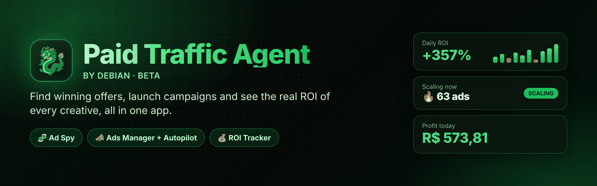
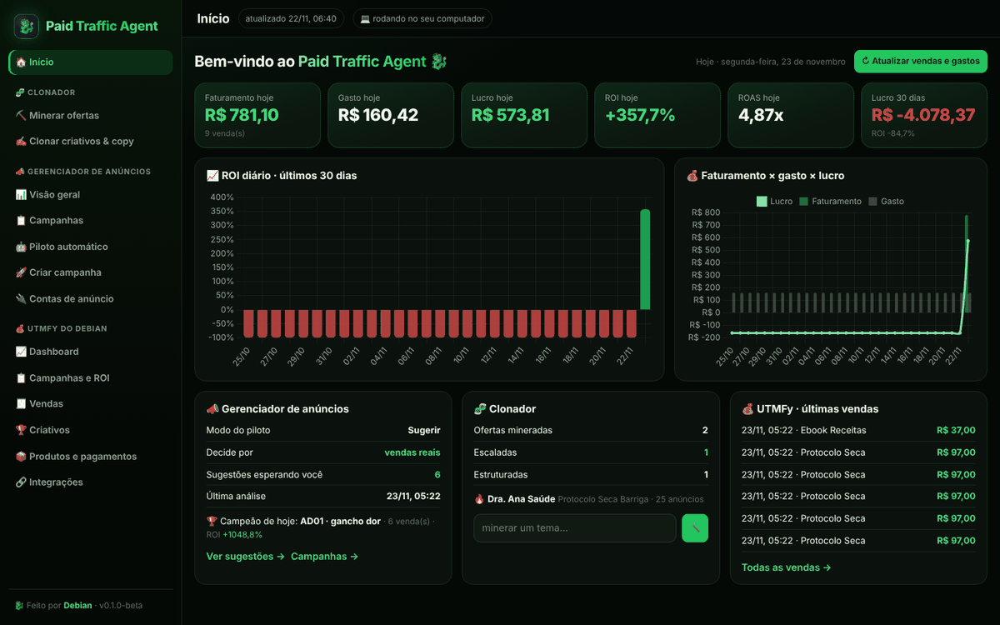
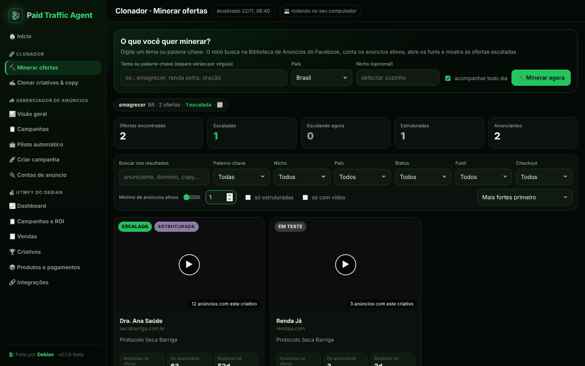
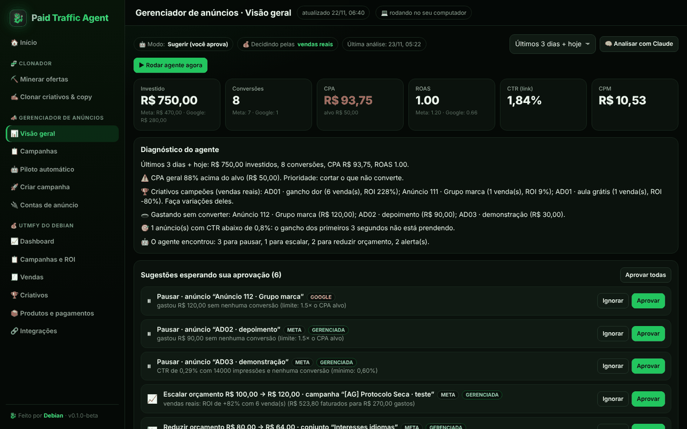
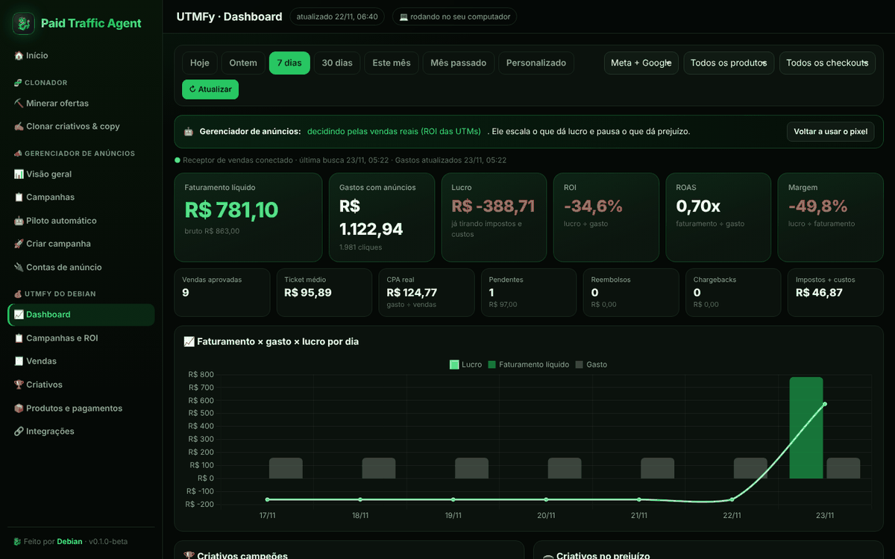
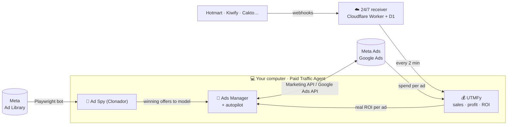

<div align="center">



[Português](README.md) · **English**

[](https://github.com/AlvaroBaarros/paid-traffic-agent/releases) [](https://github.com/AlvaroBaarros/paid-traffic-agent/actions/workflows/testes.yml)   [](LICENSE)

### Find winning offers, launch campaigns and see the real ROI of every creative, all in one app.

</div>

---

> [!NOTE]
> **Free beta.** Download it, use it and tell us what you think in the [Issues](https://github.com/AlvaroBaarros/paid-traffic-agent/issues). While we test with real ad accounts, keep the autopilot in **Suggest** mode for the first few days.
>
> The app interface is currently in **Brazilian Portuguese**. An English interface is on the roadmap.

## 🎯 What it is for

Media buyers usually juggle three separate tools: one to spy on competitors' offers, the Meta Ads Manager, and a UTM tracker to find out what actually sells. **Paid Traffic Agent** brings the three together in one app that runs on your own computer. Because they share data, the autopilot decides what to pause and what to scale based on the **real sales** that hit your checkout, not just on what the pixel reports.

<table>
<tr>
<td width="33%" valign="top">

### 🧬 Ad Spy <sub>(Clonador)</sub>
Type a topic and the bot scans the Meta Ad Library.
- **Scaled**, scaling and testing offers
- Active ads per offer and per advertiser
- Funnel type (VSL, quiz…), checkout and a **structured** badge
- Downloadable videos and ad copy to study
- Filters by niche, country, keyword and minimum ads

</td>
<td width="33%" valign="top">

### 📣 Ads Manager <sub>(Gerenciador)</sub>
Connects to **Meta** and **Google Ads**.
- Overview, campaigns and ad sets with metrics
- **Autopilot** pauses what spends without selling and scales what's profitable
- Off, Suggest and Automatic modes with a budget ceiling
- Creates Meta campaigns (always paused)
- Writes hooks, ad copy and video scripts modeled on winning offers

</td>
<td width="33%" valign="top">

### 💰 ROI Tracker <sub>(UTMFy)</sub>
Real sales tied to every ad.
- **Hotmart, Kiwify and Cakto** with dedicated parsers (plus others)
- Revenue, spend, **profit, ROI, ROAS**, real CPA
- Campaigns, sales, winning and losing creatives
- Free 24/7 receiver on Cloudflare
- Feeds the autopilot with real ROI

</td>
</tr>
</table>

The **Home** page puts it all together: today's numbers, a **daily ROI chart**, revenue × spend × profit for the last 30 days and a setup checklist.

## 📸 Screenshots

| Home | Ad Spy |
|:---:|:---:|
|  |  |
| **Ads Manager** | **ROI Tracker** |
|  |  |

## ⚙️ How it works



The autopilot is **not an AI making blind decisions**. It follows rules with thresholds you set, always looking at the last 3 days + today:

| Situation | Action |
|---|---|
| Ad spent 1.5× the target CPA with no sales | ⏸ Pause |
| Ad sells, but real ROI is below −30% | ⏸ Pause |
| Campaign with 3+ sales and real ROI above +30% | 📈 Raise budget by 20% (at most once per 24h, up to your ceiling) |
| Campaign selling at a negative ROI | 📉 Cut budget by 20% |
| Audience has seen the same ad more than 3× | ⚠️ Warns you it's time for a new creative |

It never pauses the last active ad in an ad set, never deletes anything, and only acts on its own in the campaigns you allow. Full details in the [Manual](MANUAL.md) (Portuguese).

## 🛠️ How it was built

Paid Traffic Agent was designed by **Debian** and built with **Claude (Anthropic)** as a pair programmer. The goal was something lightweight that anyone can run for free: no database to install, no heavy frameworks and no paid server.

| | |
|---|---|
| **Languages** | JavaScript (Node.js 18+, ES Modules) · HTML5 · CSS3 · Bash · Batch |
| **Server** | Plain Node.js (`http`), no frameworks, bound to `localhost` only |
| **UI** | Build-free HTML/CSS/JS, dark green theme, responsive (desktop and mobile) |
| **Ad Spy bot** | [Playwright](https://playwright.dev) + Chromium |
| **Charts** | [Chart.js](https://www.chartjs.org) |
| **Integrations** | Meta Marketing API v25 · Google Ads API v26 · Hotmart/Kiwify/Cakto webhooks · Claude API (optional) |
| **Cloud (free, optional)** | Cloudflare Workers + D1 (sales receiver) · GitHub Actions/Pages (mining and tests) |
| **Quality** | 90+ automated checks and API simulators, run on Windows, macOS and Linux on every change |

**Code by the numbers:** about 5,300 lines: 62% server-side JavaScript, 21% browser JavaScript and 14% HTML/CSS.

```text
servidor.mjs          local server (plain Node.js, no frameworks) + API routes
site/                 UI: index.html (sidebar, Home), trafego.js, analytics.js
scripts/              Ad Spy bot (Playwright) and Ad Library parsing
trafego/              Ads Manager: Meta/Google clients, rules engine, agent, copywriting
analytics/            ROI Tracker: webhook parsing, UTM attribution, reports, Worker
test/                 automated tests + API simulators (Meta, Google, Claude, Ad Library)
.github/workflows/    tests on Windows/macOS/Linux, releases and cloud mining
```

## ⬇️ Download and install

1. Install **Node.js 18+** (free): the **LTS** version from [nodejs.org](https://nodejs.org/en/download).
2. Download the latest `.zip` from [**Releases**](https://github.com/AlvaroBaarros/paid-traffic-agent/releases) and unzip it.
3. Open it with the launcher for your system:

| System | How to open |
|---|---|
| 🪟 **Windows** | Double-click `iniciar-windows.bat`. If you see “Windows protected your PC”: **More info → Run anyway**. |
| 🍎 **macOS** (Apple Silicon and Intel) | Right-click `iniciar-mac.command` → **Open** → **Open** (first time only). Then just double-click it. |
| 🐧 **Linux** | `./iniciar-linux.sh` |

The first run installs everything automatically (a few minutes) and opens the app at **http://localhost:3000**. To quit, close the terminal window. To update, unzip the new version over the old folder: your data stays, and the sidebar tells you when a new version is out.

## 🚀 Getting started

1. **Gerenciador de anúncios → Contas de anúncio** (Ads Manager → Ad accounts): connect Meta (and Google, if you use it).
2. **UTMFy → Integrações** (Integrations): turn on the sales receiver, paste the webhooks into your checkout and the UTMs into your ads.
3. **Gerenciador de anúncios → Piloto automático** (Autopilot): set your target CPA, choose **real sales** and tag the campaigns with 🤖.
4. **Clonador** (Ad Spy): type a topic and click **Minerar agora** (Mine now).

## 💸 Costs

| | |
|---|---|
| Paid Traffic Agent (beta) | **Free** |
| Analysis, autopilot and mining | Free (plain math: no AI, no tokens) |
| Meta and Google APIs · Cloudflare · GitHub | Free on their free plans |
| Copywriting / analysis with Claude | Free by opening it in your own Claude, or a few cents with an API key (optional) |

The only money you spend is your ad budget.

## 🔒 Security and privacy

- It runs **on your computer**. Tokens, campaigns and sales live in `trafego.local.json` and `trafego-dados/`, which never go to GitHub.
- The app only accepts commands from itself: other websites open in your browser can't touch your campaigns.
- Never paste tokens or customer data into Issues.

## 🗺️ Roadmap

- [ ] 24/7 online version (Cloudflare) with login
- [ ] English interface
- [ ] TikTok Ads
- [ ] More checkouts with dedicated parsers
- [ ] Mobile notifications for sales and autopilot actions

## ⚖️ Disclaimer

Independent project, **not affiliated** with Meta, Google, Hotmart, Kiwify, Cakto or any other platform mentioned. Ad Spy reads the public Meta Ad Library, and Meta's terms do not allow automated collection: use it sparingly and at your own risk. Use videos and copy to **study and model** offers, not to republish them. No results are guaranteed.

## 📄 License

**Free to use, including for your own business.** Without permission you may not sell, rent, resell or offer the app as a service. See [LICENSE](LICENSE) (PolyForm Noncommercial 1.0.0 + additional permission).

<div align="center">

**🐉 Made by Debian**

<sub>Paid Traffic Agent · paid-traffic-agent</sub>

</div>
