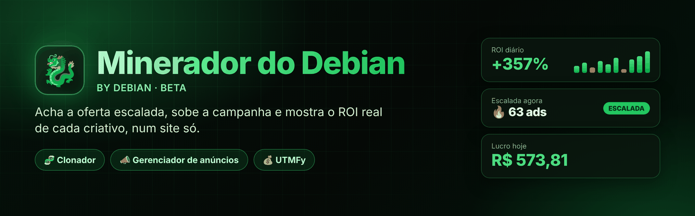
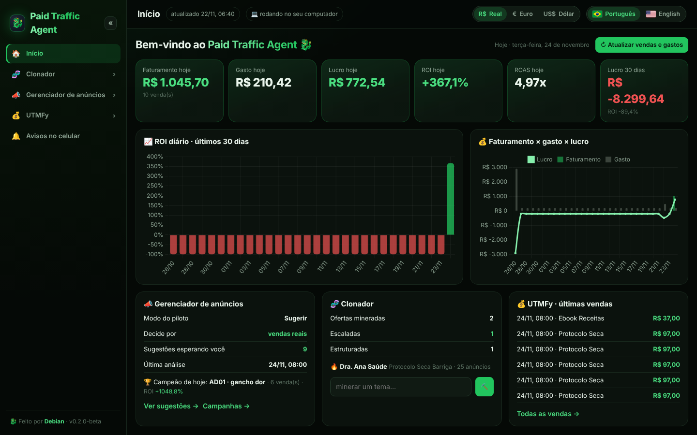
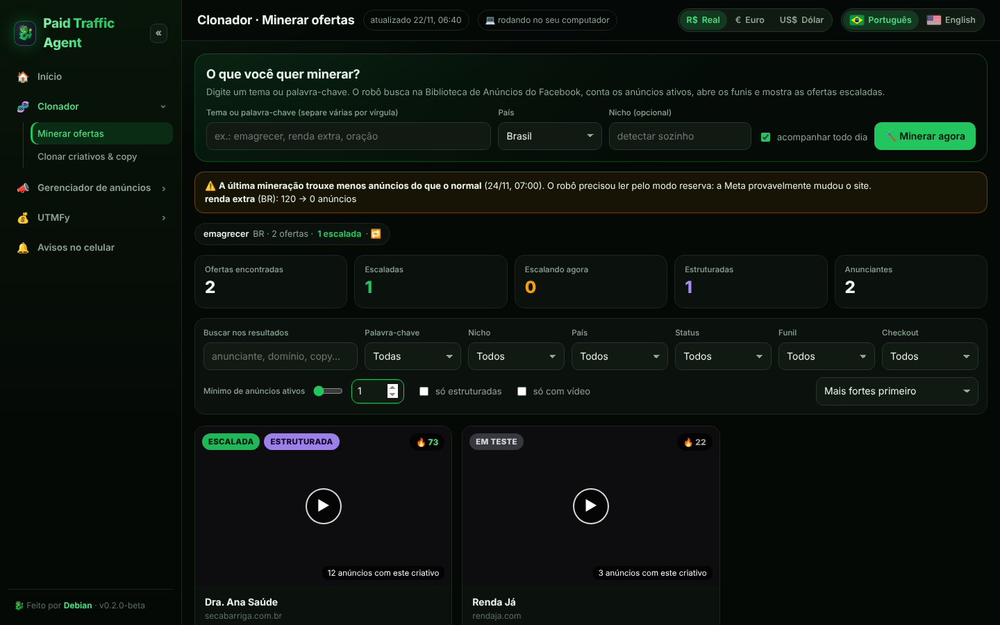
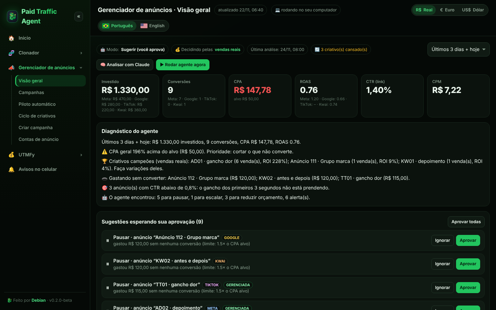
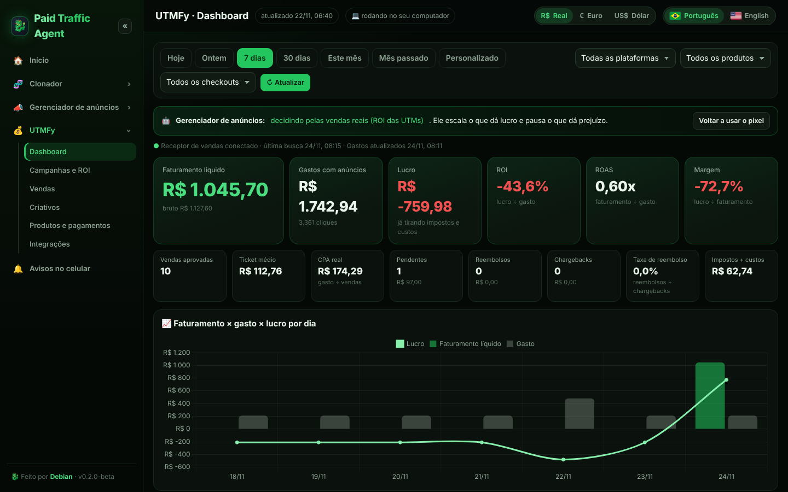
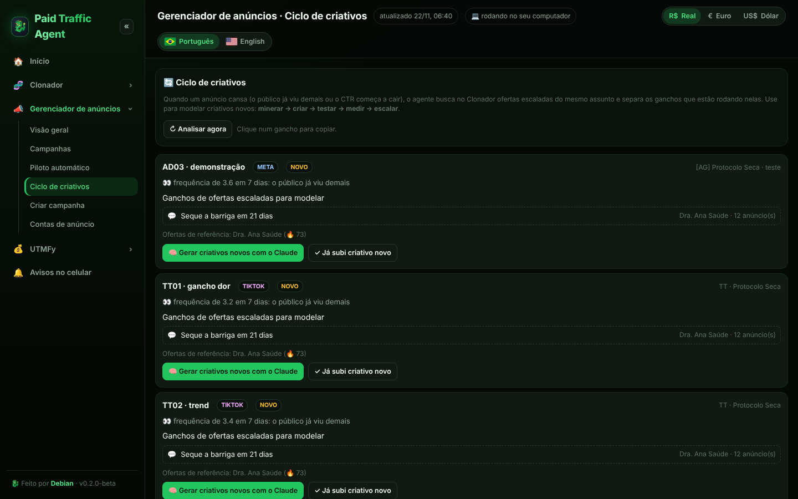
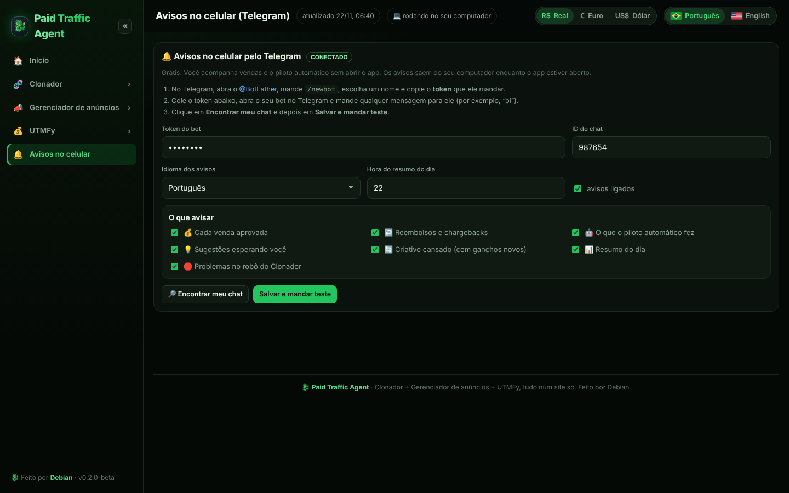
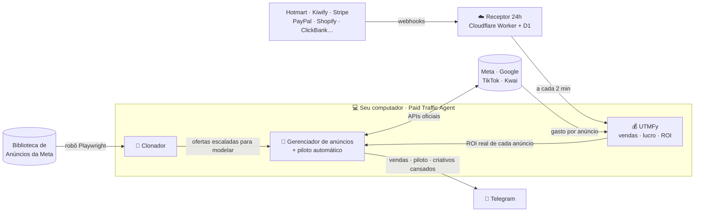

<div align="center">



**Português** · [English](README.en.md)

[](https://github.com/AlvaroBaarros/paid-traffic-agent/releases) [](https://github.com/AlvaroBaarros/paid-traffic-agent/actions/workflows/testes.yml)   [](LICENSE)

### Ache ofertas escaladas, suba campanhas e veja o ROI real de cada criativo, num app só.

</div>

---

> [!NOTE]
> **Beta gratuito.** Baixe, use e conte o que achou nas [Issues](https://github.com/AlvaroBaarros/paid-traffic-agent/issues). Enquanto testamos com contas reais, deixe o piloto automático no modo **Sugerir** nos primeiros dias.

> [!TIP]
> **Novo na v0.2.0-beta:** TikTok Ads e Kwai Ads, app em **português e inglês** (botão com a bandeira 🇧🇷/🇺🇸), avisos no celular pelo **Telegram**, **ciclo de criativos** automático, **reembolsos e chargebacks por anúncio**, Clonador com **nota de força da oferta**, checkouts e gateways do **Brasil, EUA e Europa**, seletor de moeda **Real · Euro · Dólar** no topo, e menu lateral mais simples. Veja o [CHANGELOG](CHANGELOG.md).

## 🎯 Para que serve

Quem vive de tráfego pago normalmente usa três ferramentas separadas: uma para espionar ofertas, o Gerenciador de Anúncios da Meta e uma ferramenta de UTMs para saber o que vende de verdade. O **Paid Traffic Agent** junta as três num app que roda no seu computador, em português ou inglês, e funciona no Brasil, nos EUA e na Europa. Como elas conversam entre si, o piloto automático decide o que pausar e o que escalar com base na **venda real** que entrou no seu checkout, e não só no que o pixel acha.

<table>
<tr>
<td width="33%" valign="top">

### 🧬 Clonador
Você digita um tema e o robô varre a Biblioteca de Anúncios.
- Ofertas **escaladas**, escalando ou em teste
- Anúncios ativos da oferta e do anunciante
- Funil (VSL, quiz…), checkout e selo **estruturada**
- Vídeos para baixar e copy para estudar
- Nota de **força da oferta** (0 a 100) e tendência ▲▼
- Aviso quando a Meta muda o site e o robô lê menos
- Filtros por nicho, 25+ países, palavra-chave e mínimo de anúncios

</td>
<td width="33%" valign="top">

### 📣 Gerenciador de anúncios
Conecta na **Meta**, **Google Ads**, **TikTok Ads** e **Kwai Ads**.
- Visão geral, campanhas e conjuntos com métricas
- **Piloto automático**: pausa o que gasta sem vender e escala o que dá lucro
- Modos Desligado, Sugerir e Automático, com teto de orçamento
- Cria campanhas na Meta (sempre pausadas)
- **Ciclo de criativos:** avisa quando o criativo cansa e traz ganchos novos do Clonador
- Gera ganchos, copies e roteiros em português, inglês ou espanhol

</td>
<td width="33%" valign="top">

### 💰 UTMFy
Vendas reais ligadas a cada anúncio.
- **35+ checkouts e gateways** do Brasil, EUA e Europa: Hotmart, Kiwify, Stripe, PayPal, Shopify, ClickBank, Mercado Pago…
- Faturamento, gasto, **lucro, ROI, ROAS**, CPA real, em R$, US$, € ou £
- **Reembolsos e chargebacks por anúncio**
- Campanhas, vendas, criativos campeões e no prejuízo
- Receptor 24h grátis na Cloudflare
- Alimenta o piloto automático com o ROI real

</td>
</tr>
</table>

A página **Início** junta tudo: números do dia, **gráfico de ROI diário**, faturamento × gasto × lucro dos últimos 30 dias e o checklist do que falta conectar. E os **📱 avisos no Telegram** mandam para o seu celular cada venda, reembolso, ação do piloto e o resumo do dia.

## 📸 Telas

| Início | Clonador |
|:---:|:---:|
|  |  |
| **Gerenciador de anúncios** | **UTMFy** |
|  |  |
| **Ciclo de criativos** | **Avisos no celular** |
|  |  |

## ⚙️ Como funciona



O piloto automático **não é uma IA tomando decisões no escuro**. Ele segue regras com números que você define, sempre olhando os últimos 3 dias + hoje:

| Situação | Ação |
|---|---|
| Anúncio gastou 1,5× o CPA alvo sem vender | ⏸ Pausa |
| Anúncio vende, mas com ROI real abaixo de −30% | ⏸ Pausa |
| Campanha com 3+ vendas e ROI real acima de +30% | 📈 Sobe o orçamento em 20% (no máximo 1×/24h, até o teto) |
| Campanha vendendo com ROI negativo | 📉 Reduz o orçamento em 20% |
| Público vendo o mesmo anúncio mais de 3×, ou CTR caindo 30% | 🔄 Avisa e sugere ganchos novos de ofertas escaladas |
| Anúncio com mais de 15% de reembolsos + chargebacks | ↩️ Avisa e não escala |

Ele nunca pausa o último anúncio ativo de um conjunto, nunca apaga nada e só age sozinho nas campanhas que você marcar. Detalhes no [Manual](MANUAL.md).

## 🛠️ Como foi feito

O Paid Traffic Agent foi idealizado por **Debian** e desenvolvido com o **Claude (Anthropic)** como par de programação. A ideia foi fazer algo leve, que qualquer pessoa consiga rodar de graça: sem banco de dados para instalar, sem frameworks pesados e sem servidor pago.

| | |
|---|---|
| **Linguagens** | JavaScript (Node.js 18+, ES Modules) · HTML5 · CSS3 · Bash · Batch |
| **Servidor** | Node.js puro (`http`), sem frameworks, rodando só em `localhost` |
| **Interface** | HTML/CSS/JS sem build, tema escuro verde, responsiva, em português e inglês |
| **Robô do Clonador** | [Playwright](https://playwright.dev) + Chromium |
| **Gráficos** | [Chart.js](https://www.chartjs.org) |
| **Integrações** | Meta Marketing API v25 · Google Ads API v26 · TikTok API for Business v1.3 · Kwai for Business API · Telegram Bot API · 35+ checkouts e gateways (Stripe, PayPal, Shopify, Hotmart…) · Claude API (opcional) |
| **Nuvem (grátis, opcional)** | Cloudflare Workers + D1 (receptor de vendas) · GitHub Actions/Pages (mineração e testes) |
| **Qualidade** | 150+ verificações automáticas e simulações das APIs, rodando em Windows, macOS e Linux a cada mudança |

**Código em números:** cerca de 7.600 linhas, sendo 49% JavaScript no servidor, 21% JavaScript na interface (com o dicionário de inglês), 10% HTML/CSS e 10% testes.

```text
servidor.mjs          servidor local (Node.js puro, sem frameworks) + rotas da API
site/                 interface: index.html (menu lateral, Início), trafego.js, analytics.js
scripts/              robô do Clonador (Playwright) e funções de leitura da Biblioteca
site/i18n*.js         troca de idioma português ⇄ inglês
trafego/              Gerenciador: Meta, Google, TikTok, Kwai, motor de regras, agente, ciclo de criativos
analytics/            UTMFy: leitura dos webhooks (35+ checkouts/gateways), UTMs, moedas, relatórios, Worker
notificacoes/         avisos no celular pelo Telegram
test/                 testes automáticos + simulações das APIs (Meta, Google, Claude, Biblioteca)
.github/workflows/    testes em Windows/macOS/Linux, releases e mineração na nuvem
```

## ⬇️ Baixar e instalar

1. Instale o **Node.js 18+** (grátis): versão **LTS** em [nodejs.org](https://nodejs.org/pt-br/download).
2. Baixe o `.zip` mais recente em [**Releases**](https://github.com/AlvaroBaarros/paid-traffic-agent/releases) e descompacte.
3. Abra pelo arquivo do seu sistema:

| Sistema | Como abrir |
|---|---|
| 🪟 **Windows** | Dois cliques em `iniciar-windows.bat`. Se aparecer “O Windows protegeu o computador”: **Mais informações → Executar assim mesmo**. |
| 🍎 **macOS** (Apple Silicon e Intel) | Botão direito em `iniciar-mac.command` → **Abrir** → **Abrir** (só na primeira vez). Depois, dois cliques. |
| 🐧 **Linux** | `./iniciar-linux.sh` |

Na primeira vez ele instala tudo sozinho (alguns minutos) e abre o app em **http://localhost:3000**. Para fechar, feche a janela preta. Para atualizar, descompacte a versão nova por cima: seus dados continuam lá, e o menu lateral avisa quando sai versão nova.

## 🚀 Primeiros passos

1. **Gerenciador de anúncios → Contas de anúncio:** conecte a Meta, o Google, o TikTok ou o Kwai.
2. **UTMFy → Integrações:** ligue o receptor de vendas, cole os webhooks no checkout e as UTMs nos anúncios.
3. **Gerenciador de anúncios → Piloto automático:** defina o CPA alvo, escolha **vendas reais** e marque com 🤖 as campanhas.
4. **Avisos no celular:** crie um bot no Telegram (2 minutos) e receba tudo no celular.
5. **Clonador:** digite um tema e clique em **Minerar agora**.

Quer o app em inglês? Clique na bandeira 🇺🇸 no topo. Quer ver em euro ou dólar? Use o seletor **R$ · € · US$** ao lado.

## 💸 Custos

| | |
|---|---|
| Paid Traffic Agent (beta) | **Grátis** |
| Análise, piloto automático e mineração | Grátis (é cálculo: não usa IA nem tokens) |
| APIs da Meta, Google, TikTok e Kwai · Telegram · Cloudflare · GitHub | Grátis |
| Gerar copy / analisar com o Claude | Grátis abrindo no seu Claude, ou centavos com chave de API (opcional) |

O único dinheiro que sai é a verba dos seus anúncios.

## 🔒 Segurança e privacidade

- Roda **no seu computador**. Tokens, campanhas e vendas ficam em `trafego.local.json` e `trafego-dados/`, que nunca vão para o GitHub.
- O app só aceita comandos dele mesmo: outro site aberto no navegador não consegue mexer nas suas campanhas.
- Nunca cole tokens ou dados de clientes em Issues.

## 🗺️ Próximos passos

- [x] Interface em inglês
- [x] TikTok Ads e Kwai Ads
- [x] Checkouts e gateways do Brasil, EUA e Europa
- [x] Avisos de venda e do piloto no celular (Telegram)
- [ ] Versão online 24h (Cloudflare), com login
- [ ] Criar campanhas no TikTok e no Kwai direto pelo app
- [ ] Mais idiomas (espanhol)

## ⚖️ Aviso

Projeto independente, **sem afiliação** com Meta, Google, TikTok, Kwai, Telegram, Hotmart, Kiwify, Stripe, PayPal ou outras plataformas citadas. O Clonador lê a Biblioteca de Anúncios pública, e os termos da Meta não permitem coleta automatizada: use com moderação e por sua conta. Use vídeos e copies para **estudar e modelar**, não para republicar. Nenhum resultado é garantido.

## 📄 Licença

**Uso grátis, inclusive no seu próprio negócio.** Sem autorização, não é permitido vender, alugar, revender ou oferecer o app como serviço. Veja [LICENSE](LICENSE) (PolyForm Noncommercial 1.0.0 + permissão adicional).

<div align="center">

**🐉 Feito por Debian**

<sub>Paid Traffic Agent · paid-traffic-agent</sub>

</div>
